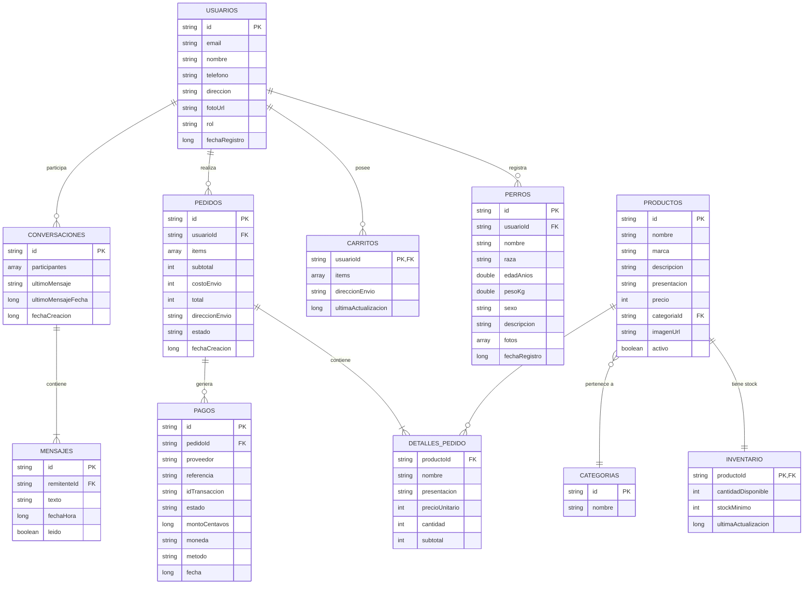

# Documento Técnico Consolidado — Age Dogs

## 1. Esquema de Colecciones (11 Entidades)

### 1. `usuarios` (`usuarios/{userId}`)
- **Campos**: `id` (String), `email` (String), `nombre` (String), `telefono` (String), `direccion` (String), `fotoUrl` (String), `rol` (String: "cliente", "admin", "veterinario"), `fechaRegistro` (Long).
- **Ejemplo JSON**:
  ```json
  {
    "id": "U12345",
    "email": "carlos@agedogs.com",
    "nombre": "Carlos Pérez",
    "telefono": "+573001234567",
    "direccion": "Calle 100 # 15-20, Bogotá",
    "fotoUrl": "https://images.unsplash.com/...",
    "rol": "cliente",
    "fechaRegistro": 1710000000000
  }
  ```
- **Claves y Relaciones**: `id` es PK (coincide con el `uid` de Firebase Auth). Relación 1:N con `perros`, `pedidos`, `carritos`.

---

### 2. `perros` (`perros/{perroId}`)
- **Campos**: `id` (String), `usuarioId` (String), `nombre` (String), `raza` (String), `edadAnios` (Double), `pesoKg` (Double), `sexo` (String), `descripcion` (String, máx 300), `fotos` (Array de Strings, máx 5), `fechaRegistro` (Long).
- **Ejemplo JSON**:
  ```json
  {
    "id": "P98765",
    "usuarioId": "U12345",
    "nombre": "Canela",
    "raza": "Labrador",
    "edadAnios": 3.0,
    "pesoKg": 24.5,
    "sexo": "Hembra",
    "descripcion": "Perrita muy amigable y enérgica.",
    "fotos": ["https://images.unsplash.com/..."],
    "fechaRegistro": 1710000000000
  }
  ```
- **Claves y Relaciones**: `id` es PK. `usuarioId` es FK hacia `usuarios.id`.

---

### 3. `productos` (`productos/{productoId}`)
- **Campos**: `id` (String), `nombre` (String), `marca` (String), `descripcion` (String), `presentacion` (String), `precio` (Int en COP), `categoriaId` (String), `imagenUrl` (String), `activo` (Boolean).
- **Ejemplo JSON**:
  ```json
  {
    "id": "demo_1",
    "nombre": "Pro Plan Adult OptiDerma",
    "marca": "Purina",
    "descripcion": "Alimento seco para perros adultos con piel sensible.",
    "presentacion": "Bulto 15 kg",
    "precio": 185000,
    "categoriaId": "Concentrado",
    "imagenUrl": "https://images.unsplash.com/...",
    "activo": true
  }
  ```
- **Claves y Relaciones**: `id` es PK. Restricción estricta de categoría: *"Concentrado"*, *"Alimento húmedo"*, *"Snacks comestibles caninos"*.

---

### 4. `categorias` (`categorias/{categoriaId}`)
- **Campos**: `id` (String), `nombre` (String).
- **Ejemplo JSON**:
  ```json
  {
    "id": "cat_concentrado",
    "nombre": "Concentrado"
  }
  ```
- **Claves y Relaciones**: `id` es PK.

---

### 5. `inventario` (`inventario/{inventarioId}`)
- **Campos**: `productoId` (String), `cantidadDisponible` (Int), `stockMinimo` (Int), `ultimaActualizacion` (Long).
- **Ejemplo JSON**:
  ```json
  {
    "productoId": "demo_1",
    "cantidadDisponible": 25,
    "stockMinimo": 5,
    "ultimaActualizacion": 1710000000000
  }
  ```
- **Claves y Relaciones**: `productoId` es PK y FK hacia `productos.id` (1:1).

---

### 6. `carritos` (`carritos/{usuarioId}`)
- **Campos**: `usuarioId` (String), `items` (Array de ItemCarrito), `direccionEnvio` (String), `ultimaActualizacion` (Long).
- **Ejemplo JSON**:
  ```json
  {
    "usuarioId": "U12345",
    "items": [
      {
        "productoId": "demo_1",
        "nombre": "Pro Plan Adult",
        "marca": "Purina",
        "imagenUrl": "...",
        "presentacion": "Bulto 15 kg",
        "precioUnitario": 185000,
        "cantidad": 1
      }
    ],
    "direccionEnvio": "Calle 100",
    "ultimaActualizacion": 1710000000000
  }
  ```
- **Claves y Relaciones**: `usuarioId` es PK y FK hacia `usuarios.id` (1:1).

---

### 7 & 8. `pedidos` y `detallesPedido` (`pedidos/{pedidoId}`)
- **Campos**: `id` (String), `usuarioId` (String), `items` (Array de DetallePedido), `subtotal` (Int), `costoEnvio` (Int), `total` (Int), `direccionEnvio` (String), `estado` (String), `fechaCreacion` (Long), `fechaExpiracionReserva` (Long).
- **Ejemplo JSON**:
  ```json
  {
    "id": "PED-001",
    "usuarioId": "U12345",
    "items": [
      {
        "productoId": "demo_1",
        "nombre": "Pro Plan Adult",
        "presentacion": "Bulto 15 kg",
        "precioUnitario": 185000,
        "cantidad": 1,
        "subtotal": 185000
      }
    ],
    "subtotal": 185000,
    "costoEnvio": 0,
    "total": 185000,
    "direccionEnvio": "Calle 100",
    "estado": "PAGADO",
    "fechaCreacion": 1710000000000,
    "fechaExpiracionReserva": 1710001800000
  }
  ```
- **Claves y Relaciones**: `id` es PK. `usuarioId` FK hacia `usuarios.id`. `detallesPedido` embebido con snapshot de precio al comprar.

---

### 9. `pagos` (`pagos/{pagoId}`)
- **Campos**: `id` (String), `pedidoId` (String), `proveedor` (String), `referencia` (String), `idTransaccion` (String), `estado` (String), `montoCentavos` (Long), `moneda` (String), `metodo` (String), `fecha` (Long), `respuestaResumen` (String).
- **Ejemplo JSON**:
  ```json
  {
    "id": "PAY-001",
    "pedidoId": "PED-001",
    "proveedor": "Wompi",
    "referencia": "AGEDOGS-PED-001-1710000000",
    "idTransaccion": "TRX-1710000000",
    "estado": "APPROVED",
    "montoCentavos": 18500000,
    "moneda": "COP",
    "metodo": "CARD",
    "fecha": 1710000000000,
    "respuestaResumen": "Transacción aprobada Wompi Sandbox"
  }
  ```
- **Claves y Relaciones**: `id` es PK. `pedidoId` FK hacia `pedidos.id`.

---

### 10 & 11. `conversaciones` y `mensajes` (`conversaciones/{convId}/mensajes/{msgId}`)
- **Campos**:
  - Conversación: `id` (String), `participantes` (Array de 2 Strings), `ultimoMensaje` (String), `ultimoMensajeFecha` (Long), `fechaCreacion` (Long).
  - Mensaje: `id` (String), `remitenteId` (String), `texto` (String), `fechaHora` (Long), `leido` (Boolean).
- **Ejemplo JSON**:
  ```json
  {
    "id": "CONV-01",
    "participantes": ["U12345", "U67890"],
    "ultimoMensaje": "¡Hola!",
    "ultimoMensajeFecha": 1710000000000,
    "fechaCreacion": 1710000000000
  }
  ```
- **Claves y Relaciones**: `id` es PK. Subcolección `mensajes` con `remitenteId` FK hacia `usuarios.id`.

---

## 2. Diagrama Entidad-Relación (Mermaid)



---

## 3. Reglas de Seguridad de Firestore (`firestore.rules`)

```javascript
rules_version = '2';
service cloud.firestore {
  match /databases/{database}/documents {

    // Función auxiliar para verificar rol administrador
    function esAdmin() {
      return request.auth != null &&
             get(/databases/$(database)/documents/usuarios/$(request.auth.uid)).data.rol == 'admin';
    }

    // 1. Colección "usuarios" y subcolecciones (bloqueados e iaHistorial)
    match /usuarios/{userId}/{allPaths=**} {
      allow read, write: if request.auth != null && request.auth.uid == userId;
      allow update: if request.auth != null
                    && request.auth.uid == userId
                    && request.resource.data.rol == resource.data.rol;
    }

    // 2. Colección "perros" (Máximo 5 fotos)
    match /perros/{perroId} {
      allow read: if request.auth != null && resource.data.usuarioId == request.auth.uid;
      allow create: if request.auth != null
                    && request.resource.data.usuarioId == request.auth.uid
                    && request.resource.data.fotos.size() <= 5;
      allow update: if request.auth != null
                    && resource.data.usuarioId == request.auth.uid
                    && request.resource.data.usuarioId == request.auth.uid
                    && request.resource.data.fotos.size() <= 5;
      allow delete: if request.auth != null && resource.data.usuarioId == request.auth.uid;
    }

    // 3. Colección "categorias" (Lectura pública autenticada, escritura admin)
    match /categorias/{categoriaId} {
      allow read: if request.auth != null;
      allow write: if esAdmin();
    }

    // 4. Colección "productos" (Restringido solo a alimentos para perros permitidos)
    match /productos/{productoId} {
      allow read: if request.auth != null;
      allow write: if esAdmin() && request.resource.data.categoriaId in ["Concentrado", "Alimento húmedo", "Snacks comestibles caninos"];
    }

    // 5. Colección "inventario"
    match /inventario/{inventarioId} {
      allow read: if request.auth != null;
      allow write: if esAdmin();
    }

    // 6. Colección "carritos" (Del propio usuario)
    match /carritos/{usuarioId} {
      allow read, write: if request.auth != null && request.auth.uid == usuarioId;
    }

    // 7 & 8. Colección "pedidos"
    match /pedidos/{pedidoId} {
      allow read, create: if request.auth != null && request.resource.data.usuarioId == request.auth.uid;
      allow update: if request.auth != null && resource.data.usuarioId == request.auth.uid;
    }

    // 9. Colección "pagos"
    match /pagos/{pagoId} {
      allow read, write: if request.auth != null;
    }

    // 10 & 11. Colección "conversaciones" y subcolección "mensajes"
    match /conversaciones/{convId} {
      allow read, create: if request.auth != null && request.auth.uid in request.resource.data.participantes;
      allow update: if request.auth != null && request.auth.uid in resource.data.participantes;

      match /mensajes/{msgId} {
        allow read: if request.auth != null && request.auth.uid in get(/databases/$(database)/documents/conversaciones/$(convId)).data.participantes;
        allow create: if request.auth != null
                      && request.auth.uid in get(/databases/$(database)/documents/conversaciones/$(convId)).data.participantes
                      && request.resource.data.remitenteId == request.auth.uid;
        allow update, delete: if false; // Inmutabilidad de mensajes
      }
    }
  }
}
```

---

## 4. Índices Compuestos de Firestore (`firestore.indexes.json`)

```json
{
  "indexes": [
    {
      "collectionGroup": "pedidos",
      "queryScope": "COLLECTION",
      "fields": [
        { "fieldPath": "usuarioId", "order": "ASCENDING" },
        { "fieldPath": "fechaCreacion", "order": "DESCENDING" }
      ]
    },
    {
      "collectionGroup": "mensajes",
      "queryScope": "COLLECTION",
      "fields": [
        { "fieldPath": "fechaHora", "order": "ASCENDING" }
      ]
    },
    {
      "collectionGroup": "iaHistorial",
      "queryScope": "COLLECTION",
      "fields": [
        { "fieldPath": "fecha", "order": "ASCENDING" }
      ]
    }
  ],
  "fieldOverrides": []
}
```

---

## 5. Justificación Técnica para el Documento Técnico

### ¿Por qué Firebase?
1. **Sincronización en Tiempo Real**: Permite el funcionamiento de los chats y los estados de pedidos instantáneamente en múltiples dispositivos sin necesidad de implementar WebSockets complejos desde cero.
2. **Autenticación Integrada**: Firebase Auth simplifica la gestión segura de credenciales, tokens y sesiones con cifrado robusto.
3. **Persistencia Offline**: Cloud Firestore cuenta con caché local nativa, permitiendo que la aplicación funcione y lea datos recientes sin conexión a internet.
4. **Plan Gratuito (Spark)**: Ofrece cuotas sumamente generosas de lecturas, escrituras, almacenamiento y ancho de banda, cubriendo con creces los requerimientos del taller universitario.

### Integración de Servicios de IA y Mapas
- **Servicio de IA**: Se integra mediante un proxy backend / webhook (Make) que encapsula las llamadas al LLM y protege las llaves privadas de la API, manteniendo el cliente móvil seguro y desacoplado.
- **Servicio de Mapas**: Se integra mediante OpenStreetMap (`osmdroid` + Overpass API + Nominatim), ofreciendo geocodificación y geolocalización de clínicas veterinarias en tiempo real sin requerir tarjetas de crédito ni incurrir en costos de facturación de Google Cloud.
